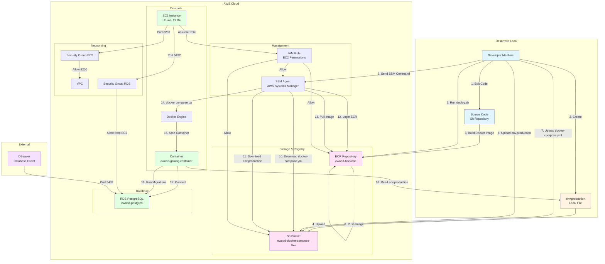

# 🏗️ Arquitectura y Flujo de Despliegue

## 📊 Diagrama de Arquitectura Completa



---

## 🔄 Flujo Detallado de Despliegue

### Fase 1: Preparación Local

```
┌─────────────────────────────────────────────────────────┐
│ 1. DESARROLLADOR (Local Machine)                        │
├─────────────────────────────────────────────────────────┤
│                                                          │
│  📝 Edita código en:                                     │
│     - cmd/server/main.go                                │
│     - internal/handler/*.go                             │
│     - migrations/*.sql                                  │
│                                                          │
│  🔐 Crea/actualiza:                                      │
│     - env.production (con credenciales de RDS)          │
│                                                          │
│  📦 Archivos listos:                                     │
│     - Dockerfile                                         │
│     - docker-compose.yml                                 │
│     - migrations/                                        │
└─────────────────────────────────────────────────────────┘
```

### Fase 2: Build y Push

```
┌─────────────────────────────────────────────────────────┐
│ 2. EJECUTA: source .env.push && ./deploy.sh            │
├─────────────────────────────────────────────────────────┤
│                                                          │
│  🔑 Login ECR:                                           │
│     aws ecr get-login-password | docker login           │
│                                                          │
│  🐳 Build Image:                                        │
│     docker build -t ewood-backend .                      │
│     ├─ Copia código fuente                              │
│     ├─ Instala dependencias Go                         │
│     ├─ Compila cmd/server → /app/server                │
│     ├─ Compila cmd/migrate → /app/migrate              │
│     └─ Copia migrations/ → /app/migrations             │
│                                                          │
│  🏷 Tag Image:                                           │
│     docker tag ewood-backend:latest                     │
│     → 262623998832.dkr.ecr.us-east-1.amazonaws.com/   │
│        ewood-backend:latest                              │
│                                                          │
│  📤 Push to ECR:                                         │
│     docker push <IMAGE_URI>                             │
│     └─ Imagen almacenada en ECR                         │
└─────────────────────────────────────────────────────────┘
```

### Fase 3: Upload de Configuración

```
┌─────────────────────────────────────────────────────────┐
│ 3. SUBIR A S3                                           │
├─────────────────────────────────────────────────────────┤
│                                                          │
│  📦 docker-compose.yml → S3:                             │
│     aws s3 cp docker-compose.yml                        │
│     s3://ewood-docker-compose-files/docker-compose.yml  │
│                                                          │
│  🔐 env.production → S3:                                 │
│     aws s3 cp env.production                            │
│     s3://ewood-docker-compose-files/env.production      │
│                                                          │
│  📍 Ubicación en S3:                                     │
│     s3://ewood-docker-compose-files/                    │
│     ├─ docker-compose.yml                              │
│     └─ env.production                                   │
└─────────────────────────────────────────────────────────┘
```

### Fase 4: Despliegue en EC2 (SSM)

```
┌─────────────────────────────────────────────────────────┐
│ 4. SSM COMMAND → EC2 INSTANCE                           │
├─────────────────────────────────────────────────────────┤
│                                                          │
│  📥 Descargar desde S3:                                  │
│     aws s3 cp s3://.../docker-compose.yml              │
│     → /home/ubuntu/docker-compose.yml                  │
│                                                          │
│     aws s3 cp s3://.../env.production                   │
│     → /home/ubuntu/env.production                      │
│                                                          │
│  🔑 Login ECR (desde EC2):                               │
│     aws ecr get-login-password | docker login           │
│                                                          │
│  📥 Pull Image:                                          │
│     docker pull <IMAGE_URI>                            │
│     └─ Descarga imagen desde ECR                        │
│                                                          │
│  🛑 Stop Container (si existe):                        │
│     docker compose down                                 │
│                                                          │
│  🚀 Start Container:                                     │
│     docker compose up -d                                │
│     └─ Levanta contenedor con env.production            │
│                                                          │
│  ⏳ Wait:                                                │
│     sleep 5                                              │
│                                                          │
│  🔄 Run Migrations:                                      │
│     docker exec ewood-golang-container                 │
│     /app/migrate -command=up -path=/app/migrations      │
│     └─ Ejecuta migraciones SQL en RDS                  │
└─────────────────────────────────────────────────────────┘
```

### Fase 5: Runtime

```
┌─────────────────────────────────────────────────────────┐
│ 5. CONTAINER EN EJECUCIÓN                               │
├─────────────────────────────────────────────────────────┤
│                                                          │
│  📂 Contenedor lee:                                      │
│     /home/ubuntu/env.production                          │
│     ├─ POSTGRES_HOST=ewood-postgres...                 │
│     ├─ POSTGRES_PASSWORD=...                           │
│     └─ ...                                              │
│                                                          │
│  🔌 Conexión a RDS:                                      │
│     postgres.Connect(...)                                │
│     └─ Conecta usando credenciales de env.production   │
│                                                          │
│  🌐 Servidor HTTP:                                       │
│     http.ListenAndServe(":8080", router)                │
│     └─ Expone puerto 8080 (mapeado a 8200 en host)     │
│                                                          │
│  📊 Endpoints disponibles:                              │
│     - http://<EC2_IP>:8200/check                        │
│     - http://<EC2_IP>:8200/health                       │
│     - http://<EC2_IP>:8200/env                          │
└─────────────────────────────────────────────────────────┘
```

---

## 📁 Ubicación de Archivos

### En Desarrollo (Local)
```
backend-ewood/
├── env.production          # ⚠️ NO commiteado (.gitignore)
├── docker-compose.yml      # ✅ Commiteado
├── Dockerfile              # ✅ Commiteado
└── migrations/             # ✅ Commiteado
```

### En S3
```
s3://ewood-docker-compose-files/
├── docker-compose.yml      # Descargado en EC2
└── env.production          # Descargado en EC2
```

### En ECR
```
262623998832.dkr.ecr.us-east-1.amazonaws.com/
└── ewood-backend:latest
    ├── /app/server         # Binario compilado
    ├── /app/migrate        # Binario de migraciones
    └── /app/migrations/     # Archivos SQL
```

### En EC2
```
/home/ubuntu/
├── docker-compose.yml      # Descargado desde S3
└── env.production          # Descargado desde S3

/root/ (en contenedor)
├── server                  # Binario del servidor
├── migrate                 # Binario de migraciones
└── migrations/             # Archivos SQL
```

---

## 🔐 Gestión de Credenciales (Actual)

### Variables de Despliegue
```
.env.push (local, NO commiteado)
├── AWS_ACCOUNT_ID
├── AWS_REGION
├── ECR_REPOSITORY
├── EC2_INSTANCE_ID
└── S3_BUCKET_NAME
```

### Variables de Runtime
```
env.production (local → S3 → EC2)
├── POSTGRES_HOST
├── POSTGRES_PASSWORD      # ⚠️ Sensible
├── POSTGRES_USER
├── POSTGRES_DB
├── MONGODB_URI            # ⚠️ Sensible (futuro)
└── ...
```

---

## 🔄 Flujo Completo (Paso a Paso)

```
1. [LOCAL] Developer edita código
   └─> git commit & push

2. [LOCAL] Developer ejecuta: source .env.push && ./deploy.sh
   │
   ├─> 2.1 Login ECR
   ├─> 2.2 Build Docker image
   ├─> 2.3 Push image to ECR
   ├─> 2.4 Upload docker-compose.yml to S3
   └─> 2.5 Upload env.production to S3

3. [LOCAL] deploy.sh envía comando SSM a EC2
   │
   └─> 3.1 SSM Agent recibe comando

4. [EC2] SSM ejecuta script de despliegue
   │
   ├─> 4.1 Descarga docker-compose.yml desde S3
   ├─> 4.2 Descarga env.production desde S3
   ├─> 4.3 Login ECR
   ├─> 4.4 Pull image desde ECR
   ├─> 4.5 docker compose down (stop old)
   ├─> 4.6 docker compose up -d (start new)
   ├─> 4.7 Wait 5 seconds
   └─> 4.8 Ejecuta migraciones

5. [EC2] Container inicia
   │
   ├─> 5.1 Lee env.production
   ├─> 5.2 Conecta a RDS PostgreSQL
   └─> 5.3 Inicia servidor HTTP en puerto 8080

6. [EXTERNAL] Acceso a aplicación
   │
   └─> http://<EC2_IP>:8200/health
```

---

## 🛡️ Seguridad y Permisos

### IAM Role de EC2
```
ec2-ssm-role-golang-ewood
├─ Permite: s3:GetObject (leer desde S3)
├─ Permite: ecr:GetAuthorizationToken (login ECR)
├─ Permite: ecr:BatchGetImage (pull images)
└─ Permite: ssm:SendCommand (recibir comandos SSM)
```

### Security Groups
```
EC2 Security Group:
├─ Ingress: Port 8200 from 0.0.0.0/0 (HTTP API)
└─ Egress: All traffic

RDS Security Group:
├─ Ingress: Port 5432 from EC2 Security Group
└─ Ingress: Port 5432 from 0.0.0.0/0 (⚠️ Solo desarrollo)
```

---

## 📊 Resumen de Componentes

| Componente | Ubicación | Propósito |
|------------|-----------|-----------|
| **Código fuente** | Git Repository | Control de versiones |
| **Docker Image** | ECR | Imagen de la aplicación |
| **docker-compose.yml** | S3 → EC2 | Configuración de contenedor |
| **env.production** | S3 → EC2 | Variables de entorno |
| **Migrations** | Docker Image | Scripts SQL versionados |
| **Runtime** | EC2 Container | Aplicación ejecutándose |
| **Database** | RDS | PostgreSQL persistente |

---

## 🚀 Próximos Pasos (Mejoras)

1. **GitHub Actions CI/CD** → Automatizar despliegue
2. **AWS Secrets Manager** → Reemplazar env.production en S3
3. **CloudWatch Logs** → Centralizar logs
4. **Health Checks** → Monitoreo automático
5. **Blue/Green Deployment** → Despliegues sin downtime

