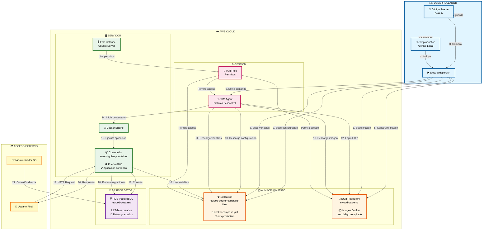
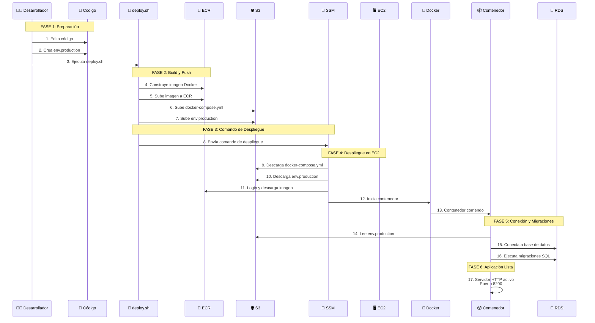
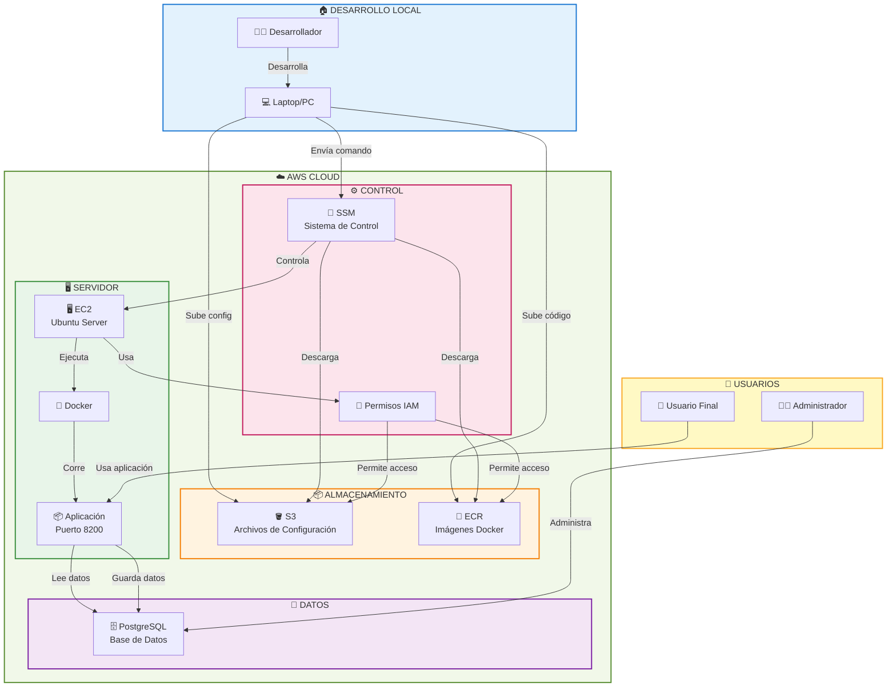
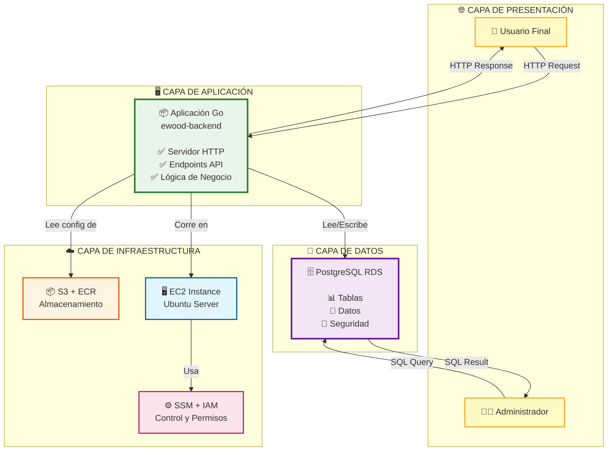
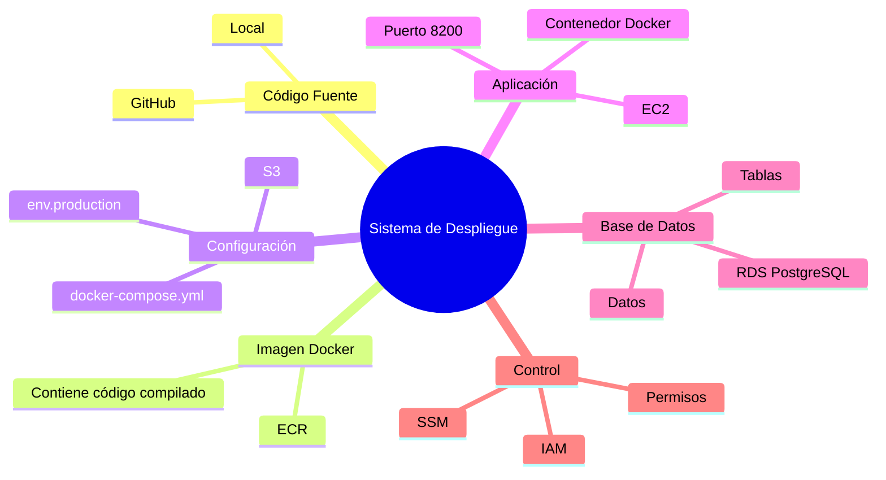
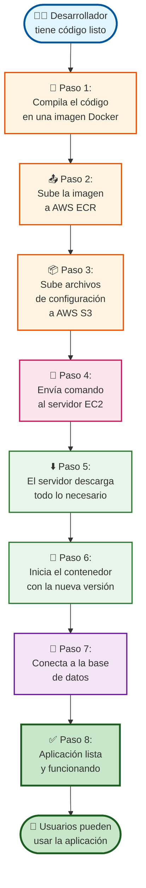

# 🚀 Flujo de Despliegue - Diagrama Visual

## 📊 Flujo Completo de Despliegue (Versión Visual)

---

## 🎯 Flujo Paso a Paso (Versión Narrativa)

---

## 🏗️ Arquitectura del Sistema (Vista General)

---

## 📋 Resumen Visual del Flujo

```mermaid
flowchart LR
    A["👨‍💻<br/>Desarrollador<br/>Edita código"] --> B["🔨<br/>Build<br/>Compila aplicación"]
    B --> C["📤<br/>Push<br/>Sube a ECR"]
    C --> D["📦<br/>Upload<br/>Sube config a S3"]
    D --> E["📡<br/>SSM<br/>Envía comando"]
    E --> F["⬇️<br/>Download<br/>Descarga en EC2"]
    F --> G["🐳<br/>Docker<br/>Inicia contenedor"]
    G --> H["💾<br/>RDS<br/>Conecta base datos"]
    H --> I["✅<br/>Listo<br/>Aplicación corriendo"]

    style A fill:#e1f5ff,stroke:#01579b,stroke-width:2px
    style B fill:#fff4e1,stroke:#e65100,stroke-width:2px
    style C fill:#fff4e1,stroke:#e65100,stroke-width:2px
    style D fill:#fff4e1,stroke:#e65100,stroke-width:2px
    style E fill:#fce4ec,stroke:#c2185b,stroke-width:2px
    style F fill:#e8f5e9,stroke:#2e7d32,stroke-width:2px
    style G fill:#e8f5e9,stroke:#2e7d32,stroke-width:2px
    style H fill:#f3e5f5,stroke:#6a1b9a,stroke-width:2px
    style I fill:#c8e6c9,stroke:#1b5e20,stroke-width:3px
```

---

## 🎨 Componentes del Sistema (Vista de Componentes)

---

## 📊 Dónde se Guarda Cada Cosa (Mapa Visual)

---

## 🎯 Flujo Simplificado para No Técnicos

---

## 💡 Explicación Simple

**¿Qué pasa cuando desplegamos?**

1. **El desarrollador** tiene código nuevo listo
2. **Se compila** el código en una "caja" (imagen Docker)
3. **Se sube** esa "caja" a un almacén (ECR)
4. **Se suben** las instrucciones (docker-compose.yml) a otro almacén (S3)
5. **Se envía** un mensaje al servidor (SSM) diciendo "¡actualízate!"
6. **El servidor** descarga todo lo nuevo
7. **El servidor** detiene la versión vieja y inicia la nueva
8. **La aplicación** se conecta a la base de datos
9. **¡Listo!** Los usuarios pueden usar la nueva versión

**Todo esto pasa automáticamente en menos de 5 minutos** ⚡

